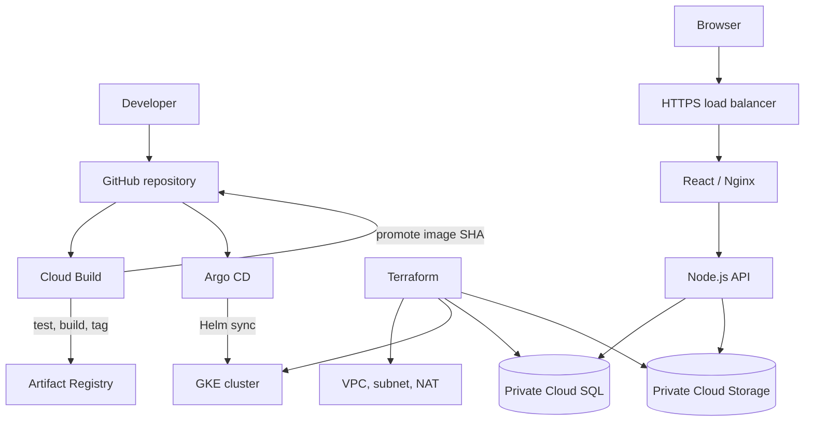

# Showcaseme


> A portfolio-building and publishing application with a GCP delivery platform built around GKE, Terraform, Cloud Build and Argo CD.

Showcaseme lets a professional bring their profile, experience, skills and selected projects together in a public portfolio. The cloud platform in this repository builds the application into containers, provisions its GCP environment, and uses Git as the deployment source of truth.

## Application

- Register and sign in to manage portfolios.
- Create and edit a portfolio with a public slug.
- Add professional experience, skills and project links.
- Save a draft, publish it, or unpublish it.
- Render published portfolios through a public route.
- Request short-lived Cloud Storage upload URLs for optional portfolio images.

The API stores account and portfolio data in PostgreSQL. The Cloud Storage bucket is private; the API signs short-lived upload URLs using its GKE workload identity.

## Architecture



### Delivery flow

| Stage | Tooling | Result |
|---|---|---|
| Source | GitHub | Versioned application and Helm configuration |
| Build and test | Cloud Build | API tests, container builds and immutable commit-SHA tags |
| Image storage | Artifact Registry | Versioned API and web images |
| Infrastructure | Terraform | VPC, GKE, IAM, Cloud SQL and Cloud Storage |
| Release packaging | Helm | Shared chart with environment values, probes, resources, HPA and PDB |
| Deployment | Argo CD | GitOps reconciliation of the Helm release |
| Operations | Cloud Logging and Cloud Monitoring | Workload logs, cluster metrics and alert policies |

Cloud Build publishes images and updates the image tags in Git. Argo CD performs the rollout; the build pipeline does not run `kubectl apply` or `helm upgrade` against the cluster.

## Repository layout

```text
.
├── api/
│   ├── migrations/
│   ├── src/
│   └── test/
├── web/
│   └── src/
├── infra/terraform/
│   ├── main.tf
│   ├── variables.tf
│   ├── outputs.tf
│   ├── iam.tf
│   └── monitoring.tf
├── deploy/
│   ├── argocd/
│   └── helm/showcaseme/
├── ci/cloudbuild.yaml
└── docs/
```

## Run locally

Requirements: Docker Engine and Docker Compose.

```bash
cp .env.example .env
# Set JWT_SECRET to a unique random value of at least 32 bytes.
docker compose up --build
```

Open [http://localhost:8080](http://localhost:8080). API liveness is available at `/api/health`; readiness is available at `/api/ready`. PostgreSQL runs in a named volume. The local stack does not need GCP credentials; signed Cloud Storage uploads require Application Default Credentials and a configured bucket.

To run API checks directly:

```bash
cd api
npm install
npm test
npm run check
```

## Deploy to GCP

The phased deployment guide is in [docs/gcp/README.md](docs/gcp/README.md), with infrastructure details in [infra/terraform/README.md](infra/terraform/README.md). In brief:

1. Create a dedicated GCP project and configure a secured remote GCS Terraform state bucket.
2. Set the project, region, trusted administrator CIDR and database password in a local tfvars file (never commit it).
3. Review and apply the Terraform plan in a non-production project.
4. Configure the Cloud Build trigger with its dedicated service account and the narrowly scoped GitHub App token stored in Secret Manager.
5. Create the Kubernetes runtime secret and install Argo CD.
6. Apply the Argo CD Application, set the domain in Helm values, and configure DNS for the GKE HTTPS load balancer.
7. Verify deployment health, Cloud SQL connectivity, Workload Identity, logs and monitoring alerts.

GKE, Cloud NAT, Cloud SQL, external load balancing and storage can incur charges. Check the Terraform plan and current GCP pricing before applying.

## CI checks

GitHub Actions validates the API, builds the frontend and both Docker images, formats and validates Terraform, and lints the Helm chart. Cloud Build is the GCP image publication and GitOps promotion pipeline.

## Operational notes

- Production image references use Git commit SHAs rather than `latest`.
- API pods use Workload Identity and a Cloud SQL Auth Proxy sidecar; Cloud SQL has no public IPv4 address.
- Cloud Storage has uniform bucket-level access and Public Access Prevention.
- HPA and node-pool autoscaling are separate controls; pod requests/limits and PDBs are included in the chart.
- Rollback is a Git revert of the image-promotion commit. Argo CD then reconciles the previous release.

See [docs/runbook.md](docs/runbook.md), [docs/troubleshooting.md](docs/troubleshooting.md), and [docs/release-and-rollback.md](docs/release-and-rollback.md) before operating a cluster.

## Scope and status

This is a hands-on portfolio implementation and deployment blueprint. No GCP resources have been provisioned by publishing the repository. Before public production use, configure real project values, DNS and TLS, secret-manager integration, branch protection, workload security tests, dependency/image scanning, and restore drills. The example does not claim a compliance certification or a live production service.
