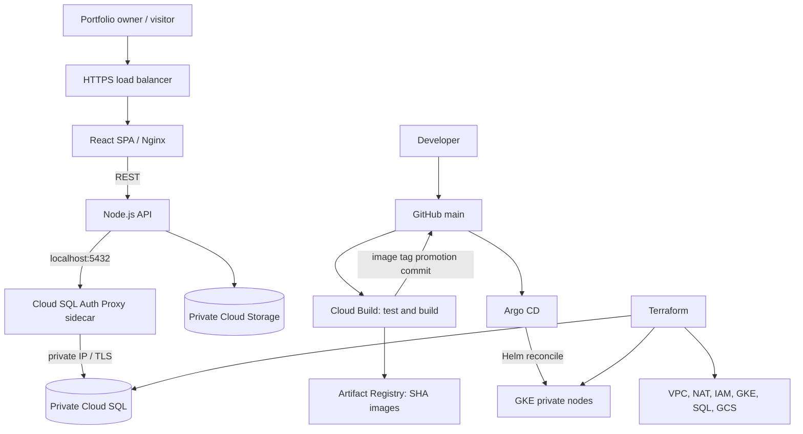

# System architecture

## Product flow

The React application supports account registration/sign-in, profile editing, experience and project capture, skills, template selection, draft management, publish/unpublish, and a public portfolio view. Public portfolios are selected through the `?portfolio=<slug>` query parameter and loaded from `/api/public/:slug`; this repository does not implement clean `/<slug>` paths or per-user subdomains. Dynamic hostnames need a separate DNS/certificate design. The bundled GKE ManagedCertificate covers one exact hostname.

## Runtime components

- **Web:** React SPA built and served by Nginx.
- **API:** Node.js/Express REST service with bcrypt password hashing, short-lived JWTs, ownership-scoped CRUD and validation.
- **Database:** Cloud SQL for PostgreSQL. SQL migrations run from the API startup path.
- **Assets:** Private Cloud Storage bucket; API issues short-lived signed upload URLs.
- **GKE:** Web/API Deployments, Services and Ingress. Helm configures probes, rolling updates, resource requests/limits, HPA, PDB, ServiceAccounts and NetworkPolicy. When HPA is enabled, the chart omits Deployment `spec.replicas` so the autoscaler is the sole replica controller; `replicaCount` applies when autoscaling is disabled.
- **Database connectivity:** Cloud SQL Auth Proxy sidecar uses private IP. The API Kubernetes ServiceAccount is mapped to a Google service account using Workload Identity.
- **Delivery:** Cloud Build tests and builds commit-SHA images, pushes to Artifact Registry and commits image tags to Git. Argo CD reconciles the Helm release from Git.

## Architecture and delivery flow

## Network and security boundaries

- Custom VPC/subnet with separate Pod and Service secondary ranges.
- Private GKE nodes use Cloud NAT for controlled egress; control-plane access is restricted to a trusted administrator CIDR.
- Cloud SQL has private IP only through private service access.
- Cloud Storage uses uniform bucket-level access and Public Access Prevention.
- API workload identity is separate from node and Cloud Build identities.

## Resilience and scaling

Readiness/liveness probes gate traffic and detect process failures. Rolling updates use `maxUnavailable=0`; API and web HPAs scale on CPU, while node-pool autoscaling manages VM capacity. PDBs protect availability during voluntary disruptions. Cloud SQL backups/PITR and bucket versioning are configured; restore procedures are documented in the operations guide.
